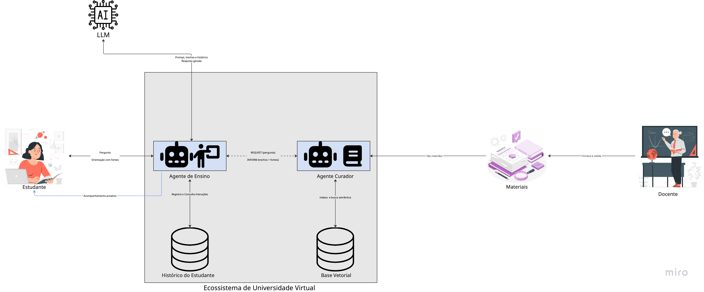

# Visão Geral da Arquitetura

A **Figura 1** apresenta a visão geral da arquitetura do **Sistema Multiagente de Apoio Pedagógico**, inserido no contexto de um **Ecossistema de Universidade Virtual**.

*Figura 1: Visão geral da arquitetura do Sistema Multiagente de Apoio Pedagógico no Ecossistema de Universidade Virtual.*

---

## 1. Visão Geral e Componentes

Internamente, o sistema é composto por **dois agentes** implementados no framework **JADE** e por **duas bases de dados**:

* **Agente Curador**: responsável pela gestão e estruturação do conhecimento factual da disciplina.
* **Agente de Ensino**: responsável pela mediação pedagógica e interação com o estudante.
* **Base Vetorial**: armazena representações vetoriais (*embeddings*) dos materiais didáticos validados para busca semântica.
* **Histórico do Estudante**: armazena o registro de interações para personalização e acompanhamento contínuo.

Externamente, o sistema se relaciona com:
* **Estudante**: usuário atendido pelo sistema, recebendo suporte tanto reativo quanto proativo.
* **Docente**: responsável por fornecer e validar os materiais didáticos da disciplina.
* **Materiais Didáticos**: fontes oficiais e validadas da disciplina.
* **Grande Modelo de Linguagem (LLM)**: serviço externo ao ecossistema utilizado para síntese e geração de linguagem natural.

---

## 2. Fluxos do Sistema

### 2.1. Fluxo de Alimentação (Curadoria e RAG)
O fluxo de alimentação do sistema começa pelo **docente**, que fornece e valida os materiais didáticos da disciplina:

1. Os materiais são inseridos no **Agente Curador**;
2. O agente estrutura o conteúdo por meio de técnicas de **Processamento de Linguagem Natural (PLN)**;
3. Os dados são indexados na **Base Vetorial** na forma de representações vetoriais, viabilizando a busca semântica.

> **Garantia de Confiabilidade:** Dessa forma, o conhecimento utilizado pelo sistema provém exclusivamente de fontes validadas pelo docente.

### 2.2. Fluxo de Interação Reativa
O fluxo de interação reativo tem início na ação do estudante:

1. **Envio da Dúvida:** O estudante envia uma pergunta ao **Agente de Ensino**;
2. **Consulta Factual:** Para obter o conteúdo factual necessário, o Agente de Ensino envia uma mensagem assíncrona do tipo `REQUEST` ao **Agente Curador**;
3. **Busca Semântica:** O Agente Curador realiza a busca semântica na **Base Vetorial** e responde com uma mensagem do tipo `INFORM`, contendo os trechos relevantes do material e suas respectivas fontes (*seguindo o padrão FIPA-ACL*);
4. **Montagem do Prompt Pedagógico:** O Agente de Ensino consulta o **Histórico do Estudante** e monta um prompt que combina:
   - As instruções pedagógicas;
   - Os trechos recuperados da curadoria;
   - O histórico recente de interações do aluno;
5. **Geração da Resposta:** O prompt é enviado ao **LLM**, que retorna a resposta gerada;
6. **Retorno e Registro:** O Agente de Ensino entrega ao estudante uma orientação acompanhada das fontes que a fundamentam e registra a interação no histórico.

### 2.3. Acompanhamento Proativo
Além do fluxo reativo (resposta sob demanda), a arquitetura prevê o **acompanhamento proativo** (representado pela **seta em azul**):

* Com base no histórico registrado, o **Agente de Ensino** pode iniciar ativamente a interação com o estudante, mesmo sem uma pergunta prévia.
* Esse comportamento proativo representa o **principal diferencial da proposta** em relação a assistentes educacionais baseados unicamente em interação sob demanda.

---

## 3. Separação de Responsabilidades

Essa organização materializa uma separação estrita de responsabilidades:

* **Agente Curador (Vertente Factual e Verificável):** Baseado em **Geração Aumentada por Recuperação (RAG)**, garante a precisão e a rastreabilidade das informações.
* **Agente de Ensino (Vertente Pedagógica):** Baseado em **Engenharia de Prompts** e no histórico do estudante, personaliza o processo de ensino-aprendizagem.

> **Mitigação de Riscos:** A combinação das duas vertentes busca mitigar limitações conhecidas dos LLMs tradicionais, como a geração de informações não verificáveis (alucinações) e a dificuldade de rastrear a procedência das fontes.

---

## 4. Notação da Figura

| Elemento Visual | Significado |
| :--- | :--- |
| **Linhas contínuas** | Fluxos de dados e chamadas entre componentes. |
| **Linhas tracejadas** | Troca de mensagens assíncronas no padrão **FIPA-ACL** entre agentes. |
| **Linha azul** | Ações e acompanhamentos proativos iniciados pelo próprio sistema. |
| **Rótulo `A / B` (setas bidirecionais)** | **`A`** indica o fluxo de quem inicia a interação e **`B`** indica o retorno. |

---

## 5. Histórico de Versões

| Versão | Data | Descrição | Autor |
| :---: | :---: | :--- | :--- |
| 1.0 | 02/10/2026 | Criação do documento com a visão geral da arquitetura, fluxos e notações | Davi Severiano |